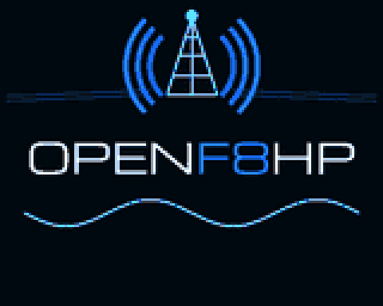
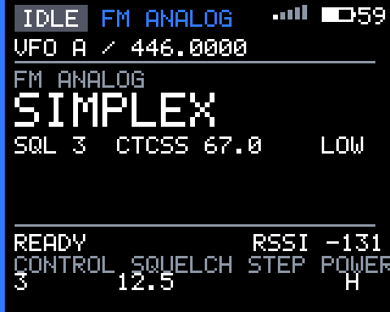
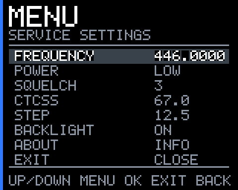
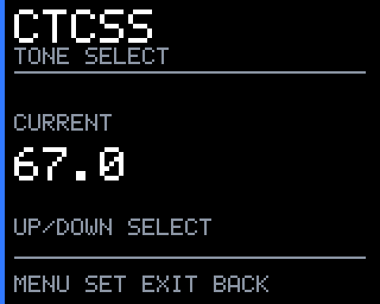
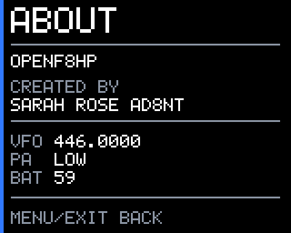

# OpenF8HP

Open-source firmware research for the **BTECH BF-F8HP Pro** (Baofeng `H802`,
NRF / NRFB hardware variants).

This repository is currently in the **reverse-engineering / bring-up** phase.
It contains the tools and notes needed to back up the radio, decode vendor
firmware, and start building a replacement image that can be flashed with the
stock KDH bootloader.

## Hardware at a glance

| Item | Finding |
| --- | --- |
| MCU | AT32F413 or AT32F415 (Cortex-M4F), 32 KiB SRAM, 128 KiB flash (likely) |
| Firmware layout | 4 KiB KDH bootloader at `0x08000000`; app at `0x08001000` |
| RF | FD6818 (`NRF`) / FD6818B (`NRFB`), 3-wire bus |
| RF bus | SCN `PB0`, SCK `PC5`, SDA `PC4` |
| Display | ST7735, 8-bit 8080 parallel bus, 160 px wide |
| LCD bus | D0–D7 `PB8–PB15`, CS `PB6`, RST `PB7`, RS `PC12`, WR `PF6`, backlight `PA4` |
| Keypad | 5 rows `PB8–PB12`, 4 columns `PB2–PB5` (rows share LCD D0–D4) |
| PTT | `PA10`, active low (shared with USART1_RX) |
| Speaker amp | `PC14`, active high |
| Power key | `PC0` |
| Config memory | 64 KiB EEPROM/address space over the CPS protocol |

See [docs/hardware.md](docs/hardware.md) for the full pin map.

## Screenshots

<table align="center">
  <tr>
    <td align="center">
      <br>
      <sub>Boot splash — wordmark only</sub>
    </td>
    <td align="center">
      <br>
      <sub>Command display — 446.0000 MHz, SQL 3, CTCSS 67.0</sub>
    </td>
  </tr>
  <tr>
    <td align="center">
      <br>
      <sub>Service menu</sub>
    </td>
    <td align="center">
      <br>
      <sub>CTCSS tone selection</sub>
    </td>
  </tr>
  <tr>
    <td align="center">
      <br>
      <sub>About screen</sub>
    </td>
    <td align="center">
      <sub>LCD captures via <code>tools/screencap.py</code><br>
      Boot splash rendered from <code>firmware/hello/splash.c</code></sub>
    </td>
  </tr>
</table>

## Tools

| Tool | Purpose |
| --- | --- |
| `tools/backup.py` | Verified 64 KiB EEPROM backup (reads twice, compares) |
| `tools/restore.py` | Guarded write-back of a backup (dry-run by default) |
| `tools/read_eeprom.py` | Read the codeplug map or the full 64 KiB space |
| `tools/kdhx.py` | Decode/encode vendor `.kdhx` firmware containers |
| `tools/kdh_bootloader.py` | KDH handshake and opcode probe |
| `tools/flash_kdhx.py` | Flash a `.kdhx` image through the KDH bootloader |
| `tools/screencap.py` | Capture the 160×128 LCD over the programming UART |
| `tools/flash_live.py` | Flash the app over serial via the resident RAM stub |
| `tools/buttons.py` | Press/release any radio button over the debug UART |

## Firmware

**Current milestone:** the `hello` bring-up image runs on real hardware —
USART1 output, ST7735 LCD, full keypad map, PTT, and **FD6818 RX at
446.000 MHz with live RSSI and audible FM voice** (confirmed: baseline
~31 → ~111 when keyed; speaker amp `PC14`). TX carrier, 1 kHz tone, and
**normal TX mic voice** are confirmed at 145.100 and 446.000 (locked V00).
The 446 build now uses a P25-inspired **Command** layout on the 160×128 LCD:
blue rail, IDLE/TX state, `FM ANALOG`, `VFO A / 446.000`, large `SIMPLEX`,
SQL/CTCSS/PWR, and `READY / RSSI`; the rail turns red in TX. P25 itself is
not supported — these are FM/analog equivalents. The firmware also has a real
ADC battery gauge, LOW/MID/HIGH PA levels (SK1), a 60 s TX timeout, serial
screen capture via [tools/screencap.py](tools/screencap.py), and live flashing
via the RAM stub in [tools/flash_live.py](tools/flash_live.py), plus a
wordmark-only `OPENF8HP` boot splash and a flashing progress bar.

- `firmware/hello/` — bring-up image linked at `0x08001000`.
  - ST7735 parallel LCD, backlight `PA4`
  - FD6818 RX (`SCN PB0`, `SCK PC5`, `SDA PC4`), 446.000 MHz + RSSI
  - RX audio: AF out/volume/squelch, speaker amp `PC14` high
  - keypad matrix rows `PB8–PB12`, columns `PB2–PB5`
  - VFO entry **100.000–999.999 MHz** from the keypad
  - PTT `PA10` active low
  - USART1 `PA9` @ 115200 for diagnostics
  - build with `make`, flash with `tools/flash_kdhx.py`
  See [firmware/hello/README.md](firmware/hello/README.md).

Backups, decoded firmware and extracted vendor files live under `work/`,
which is git-ignored.

## Quick start

```sh
python3 -m pip install pyserial
python3 tools/backup.py                 # verified EEPROM backup
python3 tools/kdhx.py file.kdhx out.bin # decode vendor firmware
```

## UI mockup

An interactive web mockup of the 160×128 radio UI (three themes) lives in
[mockup/](mockup/README.md). It is htmx + a small stdlib Python server; it does
not flash firmware.

```sh
python3 mockup/serve.py   # open http://127.0.0.1:8080/
```

## Documentation

- [docs/hardware.md](docs/hardware.md) — MCU, pin map, RF, LCD, keypad, PTT
- [docs/firmware.md](docs/firmware.md) — `.kdhx` container, memory layout, init code
- [docs/protocols.md](docs/protocols.md) — KDH bootloader, CPS protocol, EEPROM map
- [docs/log.md](docs/log.md) — chronological research log

## Safety

- Keep a verified backup before writing anything to the radio.
- The 4 KiB bootloader is **not** dumped yet. Do not attempt to disable flash
  read protection without a bootloader image and a recovery plan.
- The vendor `.kdhx` files can restore the application image; they do not
  restore the bootloader.
